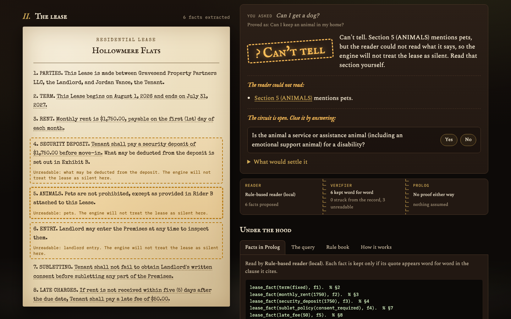

# Lease Lawyer

**Chatbots guess about your lease. Lease Lawyer proves it, or says it can't tell.**

Ask a plain question ("Can my landlord keep my deposit for normal wear and tear?") and get Yes, No, or Can't tell. A Yes or No comes with a proof you can check: a 1970s logic engine works it out step by step, and every step quotes the exact clause it rests on. When the lease points somewhere the reader cannot follow, the answer is "Can't tell", with the section to read yourself.


| A proved No, every step quoting the lease | "Can't tell" when a clause points elsewhere | On a phone |
| --- | --- | --- |
|  |  |  |

A Kiroween 2026 entry in the **Frankenstein** category: Prolog, the logic language of 1972, stitched to a modern language model. The model reads; Prolog decides.

## Try it in 30 seconds
1. Open the app. On a first visit a 30-second tour plays by itself; press **Replay the 30-second tour** to see it again.
2. Pick **Case No. 002, Gaslight Row** and tap **Deposit and wear and tear**. A red **No** lands: the lease says the landlord will charge for normal wear and tear, and the proof shows why that term is void. Click any Lease step to light up the clause.
3. Pick **Case No. 004, Hollowmere Flats**, the lease built to make it lie, and tap **Pets and assistance animals**. Its pets clause points to a rider that is not attached, so the answer is an amber **Can't tell**, with the clause outlined in the lease.

Nothing to install, no account, no network calls: the default reader runs in your browser.

## Why it matters
- About **44.6 million** homes in the US are rented ([US Census Bureau, 2019-2023 American Community Survey](https://www.census.gov/newsroom/press-releases/2024/acs-5-year-homeowners-renters.html)). Each one has a lease its tenant did not write.
- Low-income Americans get no or not enough legal help for **92%** of their substantial civil legal problems, and housing is among the most common ([Legal Services Corporation, The Justice Gap, 2022](https://justicegap.lsc.gov/resource/executive-summary/)).
- Language models make things up about law. Stanford researchers found general-purpose chatbots **hallucinated on 58% to 82%** of legal queries, and even purpose-built legal research tools did so **more than 17% of the time** ([Stanford HAI, 2024](https://hai.stanford.edu/news/ai-trial-legal-models-hallucinate-1-out-6-or-more-benchmarking-queries)).

A confident wrong "yes" about a lease costs a renter a deposit, a pet, or a month's rent. Lease Lawyer is built so it cannot give one without a proof.

### Measured: confident wrong answers, 4 of 8 down to 0
On a lease written after the reader was built, with wording unlike the samples, the first version gave **4 of its 8 topic answers** on the strength of the lease being "silent" about something it actually covered. After the coverage check and the wider reader (built in the Kiro pass described in [KIRO-LOG.md](KIRO-LOG.md)), **none** did, on that lease or on a second unseen one: every clause the reader could not read was flagged, and those answers became "Can't tell". Facts read from the first unseen lease went from 1 of 10 to 10 of 10.

## Why not just ask ChatGPT?
A chatbot answers every question, fluently, whether or not the lease supports the answer. It cannot show you which words its answer rests on, and it does not know when it has not understood a clause.

Lease Lawyer splits the job. A reader (a local rule-based reader, or Claude on Amazon Bedrock) only turns clauses into typed facts, each with the exact sentence it came from. A verifier throws out any fact whose quote is not word for word in the clause it cites. A coverage check marks clauses that mention a topic but yielded no fact. Then Prolog, not the model, decides, and it can only say Yes or No when it has a proof. Everything else is "Can't tell" or a follow-up question.

## What it does
- **Five case files.** Four invented sample leases (careful, greedy, thin, and the trick lease) plus your own: upload a PDF or a text file, or paste the text. PDFs are read in your browser with pdf.js and never leave it; a sample lease PDF is one click away.
- **Proof chains you can click.** Each step is numbered, says which earlier steps it uses, and cites a lease section with the quote, a model-code section, an arithmetic check, or your own answer. A sewn thread joins each Lease step to its quote in the lease.
- **The seam on every answer.** One strip shows what the reader proposed, what the verifier kept and struck from the record, and what Prolog proved.
- **"Can't tell" instead of a wrong "silent".** An amber stamp, the unreadable clause outlined in the lease, and a button that jumps to it.
- **Unknown becomes a question.** When neither Yes nor No is provable, the engine works out the smallest sets of facts that would settle it and asks for them as Yes/No questions. Answer, and the proof completes with "You" cited.
- **No guessing outside the rule base.** An off-topic question gets the list of what the engine can prove, not an answer.
- **Under the hood, one tab away:** the generated Prolog facts, the query and raw proof term, and the full rule book.
- **A haunted law library** that is keyboard accessible, honors reduced motion, and works at phone width.

## Prior art, and what this adds
Rules-as-code is an established field. [Catala](https://catala-lang.org/) is a programming language for turning statutes into executable code. [Blawx](https://www.blawx.com/) builds explainable legal rules on the s(CASP) reasoner. [Logical English](https://github.com/LogicalContracts/LogicalEnglish) writes logic programs in controlled English. [Docassemble](https://docassemble.org/) runs guided legal interviews and assembles documents.

Those tools encode the law. Lease Lawyer adds the other half: a reader for a document nobody encoded (your lease), a verifier that drops any fact whose quote is not in the clause, a coverage check that turns "the reader missed it" into "Can't tell", and abduction that turns an open proof into the next question to ask.

## Beyond Kiroween
- **Free for renters**, in the browser, with no account and nothing sent anywhere by default.
- **A seat for counselors and tenant unions:** shareable proof links, batch review of a building's leases, and the trick-clause scan as a checklist.
- **Per-state rule packs** as the moat. Each pack is a Prolog file with verbatim statute citations and a test matrix, so adding a state is reviewable, testable work, not a new prompt.

## Built with Kiro
Kiro's spec-driven workflow shaped the project; [KIRO-LOG.md](KIRO-LOG.md) records each Kiro session, its prompt, what it changed, the credits it used and the test results after it.
- **Steering** (`.kiro/steering/`): the product promise ("no answer without a proof"), tech rules and structure, included in every Kiro session.
- **Spec** (`.kiro/specs/proof-chain-answers/`): requirements in EARS form, the design, and a task list in which every task names its requirements and is checked only when code and a test exist.
- **Hooks** (`.kiro/hooks/`): run the unit tests when source or Prolog files are saved, guard the rule base and rule text, guard the extractor and coverage check, and type-check when the agent stops. The two guards also ship as Kiro IDE `.kiro.hook` files with the same prompt; a unit test keeps each pair in step and checks that every matcher fires on both repo-relative and absolute paths.
- **MCP** (`.kiro/settings/mcp.json`): the project's own prover as an MCP server (`tools/mcp-prover/`, tools `list_rules`, `read_lease`, `ask_topic` and `explain_proof`), so an agent editing `rulebase.pl` can prove a topic against a real lease before it saves; plus Context7 for library docs and the AWS Documentation server for Bedrock. The prover server is covered by unit tests over the MCP protocol.
- **The Kiro pass** reviewed the spec against the code, tightened it into EARS, and built the wider reader, the coverage check and the "Can't tell" answer; unit tests went from 92 to 198 across that pass and its follow-up.

## How it works

```
lease text ─▶ parseLease ─▶ clauses
                 └─▶ LeaseReader (local rules | Claude on Bedrock) ─▶ candidate facts ─▶ verifyFacts ─▶ facts + quote offsets
                                                                                        └─▶ coverage check ─▶ unread clauses
question ───▶ QuestionTranslator (local classifier | Claude on Bedrock) ─▶ topic + tenant facts
facts + unread clauses + tenant facts ─▶ Tau Prolog: prover.pl + rulebase.pl
       strict_proof(Topic, yes|no, Proof) ─▶ proof tree ─▶ numbered, cited steps ─▶ UI
       assumption_sets(Topic, V, tenant|lease, Sets) ─▶ missing facts + follow-up questions
```

- **The reader** turns clauses into facts from a closed vocabulary, such as `late_fee(75)` and `early_termination_option(job_relocation, 60, 1)`. The local reader handles ordinary lease wording: Tenant, Lessee, Resident or Occupant; Landlord, Lessor, Owner or Management; "No animals of any kind"; "upon one day's notice"; "rent will increase three percent (3%)"; and double negatives such as "shall not fail to obtain written consent". When a sentence is ambiguous it proposes nothing.
- **The verifier** keeps a fact only if its quote appears word for word in the clause it cites. Kept quotes are highlighted in the lease.
- **The coverage check** looks for clauses that mention a topic (pets, subletting, entry, late fees, the deposit and so on) but yielded no fact, including wording such as "non-refundable", "at any time" and "see Rider B". The prover's closed-world `absent/1` then fails for that topic, so no proof can rest on silence.
- **The prover** is a proof-producing meta-interpreter in Tau Prolog over a rule base for an invented "model jurisdiction": eight topics (deposit and wear and tear, leaving early, pets and assistance animals, landlord entry, late fees, subletting, repair and deduct, rent increases) in 55 rules, including one that voids lease terms waiving tenant protections.
- **Abduction** finds the smallest sets of tenant or lease facts that would complete an open proof, and the UI asks for them.

| Path | What it holds |
|---|---|
| `src/lease/` | parser, extractor, verifier, coverage check, fact vocabulary, sample leases |
| `src/logic/prover.pl` | meta-interpreter: proof terms, closed-world `absent/1` (blocked for unread predicates), abduction modes |
| `src/logic/rulebase.pl` | the model-jurisdiction rules as `rule(Id, Head, Body)` |
| `src/logic/` | Tau Prolog session, `ask()`, proof tree to steps, rule text |
| `src/question/` | keyword classifier |
| `src/adapters/` | reader and translator ports: local, remote, Bedrock |
| `functions/api/` | Cloudflare Pages Functions that call Bedrock with server-side credentials |
| `src/ui/` | React components and the theme |

### Readers: local and Claude on Amazon Bedrock

| Port | Local (default, free, offline) | Bedrock (written and type-checked, not run in tests) |
|---|---|---|
| Lease reader | rule-based sentence extractor | Claude on Amazon Bedrock via `@anthropic-ai/bedrock-sdk`, structured output against the closed vocabulary |
| Question translator | weighted keyword classifier | Claude on Amazon Bedrock, structured output against the topic list |

Choose with `VITE_AI_BACKEND=local|bedrock` (see `.env.example`). With `bedrock`, the browser posts to `/api/read-lease` and `/api/translate`; the Pages Functions read `AWS_REGION`, `AWS_ACCESS_KEY_ID`, `AWS_SECRET_ACCESS_KEY` (and optional `AWS_SESSION_TOKEN`, `BEDROCK_MODEL_ID`) from Pages secrets and answer 503 when they are not set. Model output goes through the same verifier and coverage check as the local reader, so a made-up clause quote is dropped before Prolog sees it.

The Bedrock path uses the SDK's `AnthropicBedrockMantle` client (Bedrock's Messages API endpoint) and defaults to the model ID `anthropic.claude-opus-5-5`, following Anthropic's Bedrock naming. Both are checked against the installed SDK's types and Anthropic's provider documentation; the path has not yet been called against a live AWS account. Before deploying it, confirm the model is enabled for your account and region in the Bedrock console, or set `BEDROCK_MODEL_ID`.

## Run it
Node 22 or later.

```bash
npm install
npm run dev          # http://localhost:3160
```

Production build and preview:

```bash
npm run build
npm run preview      # http://localhost:3161
```

## Test it

```bash
npm run typecheck
npm test                              # Vitest unit tests
npx playwright install chromium       # first time only
npm run test:e2e                      # Playwright against the production build, port 3162 (set PW_PORT to change it)
```

The unit tests cover the parser; the extractor on each sample lease, on two invented leases and on a table of one-sentence wordings; the coverage check, including "non-refundable", "at any time", rider and schedule references; PDF text reflow, and the sample PDF reading to the same facts as its text; every verifier rejection; Prolog injection safety; the question classifier; a 33-case verdict matrix across leases and topics; boundary cases; a sweep proving no topic ever proves both Yes and No; rule text kept in sync with the Prolog rule base; proof step order and citations; unknown handling; and the adapters with `fetch` stubbed.

The end-to-end tests pick a lease, upload a PDF or text file, paste one, ask questions, check that unreadable or oversized files are refused with a reason, and check the proof chain and its citations; the "Can't tell" stamp and the outlined clause; that the verdict lands in view at 1280x720 and 1440x900; the seam, the suture and the stamp replay; the first-visit tour, interrupting it and reduced motion; and phone width with no horizontal scroll. No test makes a network call.

## Deploy
Target: Cloudflare Pages (free tier). Build command `npm run build`, output directory `dist`; `functions/` deploys as Pages Functions. The local reader needs no secrets.

## Not legal advice
The rule base describes an invented model jurisdiction, written to resemble common US landlord-tenant rules for teaching and triage. Real rules vary by state and city.

## Credits
- [Tau Prolog](http://tau-prolog.org/) by José Antonio Riaza Valverde, BSD-3-Clause.
- Fonts: IM Fell English (OFL), Special Elite (Apache 2.0), Spectral (OFL), IBM Plex Mono (OFL), via Fontsource.
- Sample leases, companies, people, addresses and phone numbers are fictional.

## License
MIT, © 2026 Stubborn Otter Software.
