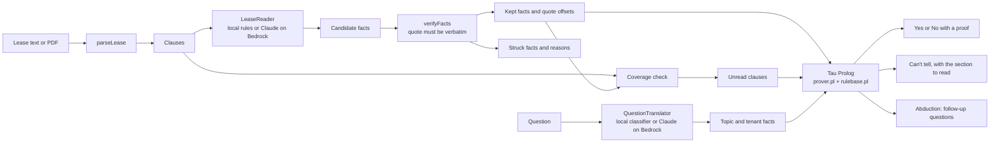

# Architecture

How Lease Lawyer turns a lease and a question into a proof, what each part holds, how the two readers differ, what the tests cover, and how it deploys. The [README](../README.md) has the short version.

The model reads; Prolog decides. A reader only proposes facts, each with the sentence it came from. Nothing reaches the prover unless its quote is word for word in the clause it cites, and a clause that mentions a topic but yielded no fact blocks any answer that would rest on the lease being silent.

## Pipeline



- **The reader** turns clauses into facts from a closed vocabulary, such as `late_fee(75)` and `early_termination_option(job_relocation, 60, 1)`. The local reader handles ordinary lease wording: Tenant, Lessee, Resident or Occupant; Landlord, Lessor, Owner or Management; "No animals of any kind"; "upon one day's notice"; "rent will increase three percent (3%)"; and double negatives such as "shall not fail to obtain written consent". When a sentence is ambiguous it proposes nothing.
- **The verifier** keeps a fact only if its quote appears word for word in the clause it cites. Kept quotes are highlighted in the lease.
- **The coverage check** looks for clauses that mention a topic (pets, subletting, entry, late fees, the deposit and so on) but yielded no fact, including wording such as "non-refundable", "at any time" and "see Rider B". The prover's closed-world `absent/1` then fails for that topic, so no proof can rest on silence.
- **The prover** is a proof-producing meta-interpreter in Tau Prolog over a rule base for an invented "model jurisdiction": eight topics (deposit and wear and tear, leaving early, pets and assistance animals, landlord entry, late fees, subletting, repair and deduct, rent increases) in 55 rules, including one that voids lease terms waiving tenant protections.
- **Abduction** finds the smallest sets of tenant or lease facts that would complete an open proof, and the UI asks for them.

| Path | What it holds |
|---|---|
| `src/lease/` | parser, extractor, verifier, coverage check, fact vocabulary, sample leases |
| `src/logic/prover.pl` | meta-interpreter: proof terms, closed-world `absent/1` (blocked for unread predicates), abduction modes |
| `src/logic/rulebase.pl` | the model-jurisdiction rules as `rule(Id, Head, Body)` |
| `src/logic/` | Tau Prolog session, `ask()`, proof tree to steps, rule text |
| `src/question/` | keyword classifier |
| `src/adapters/` | reader and translator ports: local, remote, Bedrock |
| `functions/api/` | Cloudflare Pages Functions that call Bedrock with server-side credentials |
| `src/ui/` | React components and the theme |

## Readers: local and Claude on Amazon Bedrock

| Port | Local (default, free, offline) | Bedrock (written and type-checked, not run in tests) |
|---|---|---|
| Lease reader | rule-based sentence extractor | Claude on Amazon Bedrock via `@anthropic-ai/bedrock-sdk`, structured output against the closed vocabulary |
| Question translator | weighted keyword classifier | Claude on Amazon Bedrock, structured output against the topic list |

Choose with `VITE_AI_BACKEND=local|bedrock` (see `.env.example`). With `bedrock`, the browser posts to `/api/read-lease` and `/api/translate`; the Pages Functions read `AWS_REGION`, `AWS_ACCESS_KEY_ID`, `AWS_SECRET_ACCESS_KEY` (and optional `AWS_SESSION_TOKEN`, `BEDROCK_MODEL_ID`) from Pages secrets and answer 503 when they are not set. Model output goes through the same verifier and coverage check as the local reader, so a made-up clause quote is dropped before Prolog sees it.

The Bedrock path uses the SDK's `AnthropicBedrockMantle` client (Bedrock's Messages API endpoint) and defaults to the model ID `anthropic.claude-opus-5-5`, following Anthropic's Bedrock naming. Both are checked against the installed SDK's types and Anthropic's provider documentation; the path has not yet been called against a live AWS account. Before deploying it, confirm the model is enabled for your account and region in the Bedrock console, or set `BEDROCK_MODEL_ID`.

`npm run smoke:bedrock` is that first live check. On its own it prints the plan and a cost estimate (about $0.60 at most for the seven leases) and sends nothing. With `-- --yes` it reads the five samples and the two holdout leases with Claude on Amazon Bedrock, using `AWS_ACCESS_KEY_ID`/`AWS_SECRET_ACCESS_KEY` or the profile in `AWS_PROFILE`, verifies every proposed fact as the app does, and writes one reading per lease plus a summary to `docs/bedrock-smoke/`: facts proposed, kept and struck from the record (with each struck quote and the reason), unread clauses, the holdout scores, tokens and cost. Each reading is labelled "Claude on Amazon Bedrock, recorded <date>". It stops before any call that could take the run past `--max-usd` (default $1).

## Tests

```bash
npm run typecheck
npm test                              # Vitest unit tests
npx playwright install chromium       # first time only
npm run test:e2e                      # Playwright against the production build, port 3162 (set PW_PORT to change it)
npm run eval                          # score the reader on the unseen leases in tests/holdout/
```

`.github/workflows/ci.yml` runs all four on every push and pull request. A unit test keeps each Kiro spec's task list honest: every requirement a task cites must exist, and no task is checked while a sub-task is open.

The unit tests cover the parser; the extractor on each sample lease, on two invented leases and on a table of one-sentence wordings; the coverage check, including "non-refundable", "at any time", rider and schedule references; PDF text reflow, and the sample PDF reading to the same facts as its text; every verifier rejection; Prolog injection safety; the question classifier; a 33-case verdict matrix across leases and topics; boundary cases; a sweep proving no topic ever proves both Yes and No; rule text kept in sync with the Prolog rule base; proof step order and citations; unknown handling; and the adapters with `fetch` stubbed.

The end-to-end tests pick a lease, upload a PDF or text file, paste one, ask questions, check that unreadable or oversized files are refused with a reason, and check the proof chain and its citations; the "Can't tell" stamp and the outlined clause; that the verdict lands in view at 1280x720 and 1440x900; the seam, the suture and the stamp replay; the first-visit tour, interrupting it and reduced motion; and phone width with no horizontal scroll. No test makes a network call.

## Deploy
Target: Cloudflare Pages (free tier). `wrangler.toml` holds the project settings: output directory `dist`, with `functions/` deployed as Pages Functions. The default local reader needs no secrets.

```bash
npm ci && npm run build
npx wrangler pages deploy            # first run creates the lease-lawyer project
```

`public/_headers` sets long-lived caching for the hashed assets and a few security headers. To switch the reader to Claude on Amazon Bedrock, build with `VITE_AI_BACKEND=bedrock` and set `AWS_REGION`, `AWS_ACCESS_KEY_ID` and `AWS_SECRET_ACCESS_KEY` (and optionally `BEDROCK_MODEL_ID`) as Pages secrets with `npx wrangler pages secret put <NAME>`; see `.env.example`.
